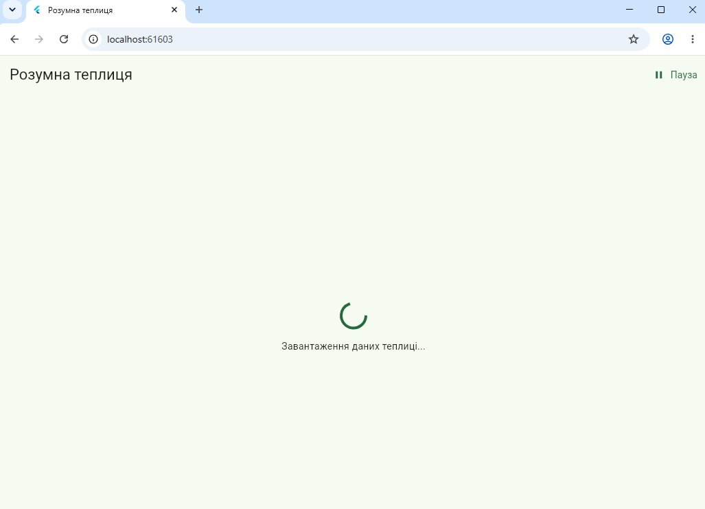
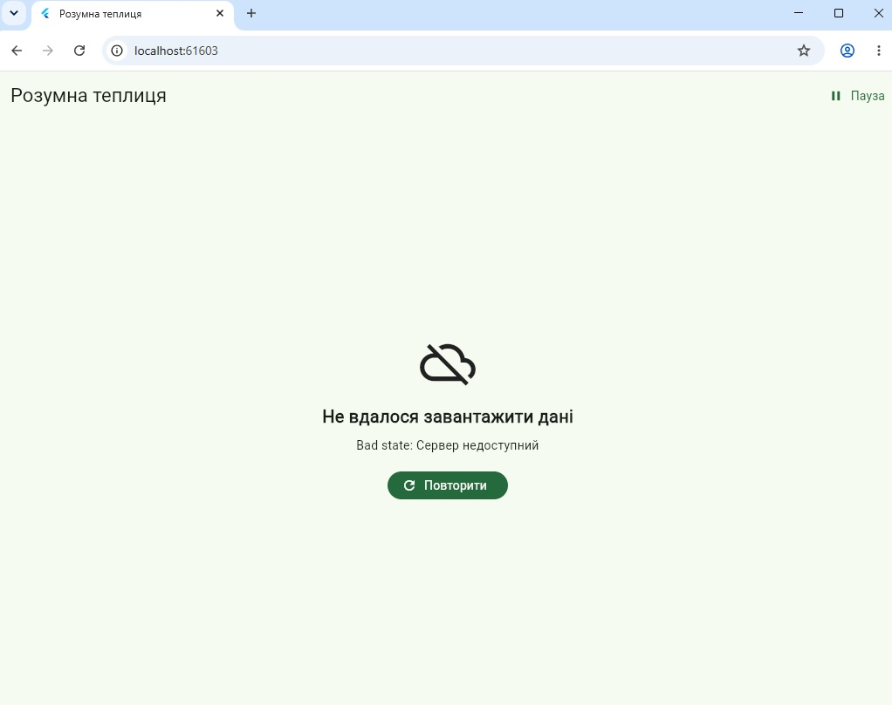
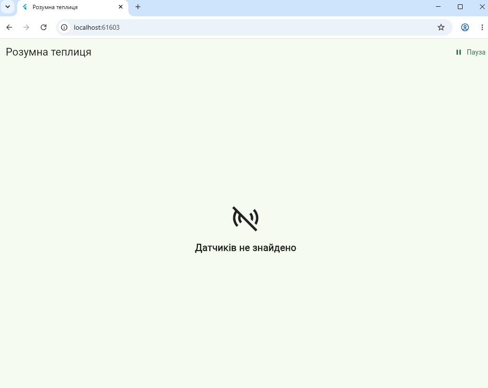
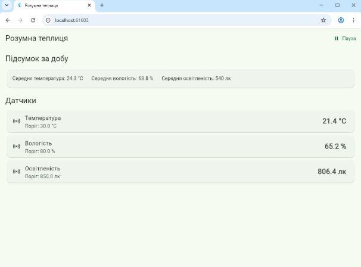
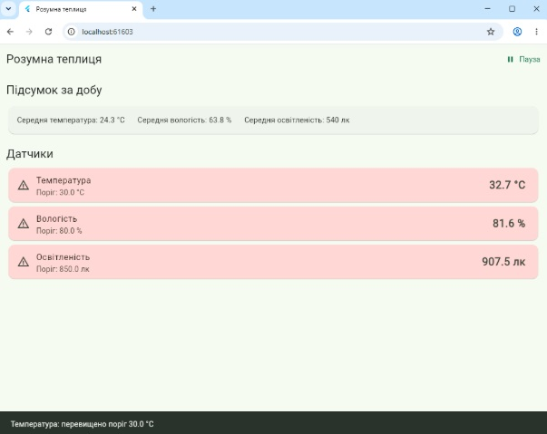

# Практична робота 8 — Робота з асинхронним кодом в Dart

**Студент:** Устич Максим  
**Група:** alk-43  
**Спеціальність:** 121 Інженерія програмного забезпечення  
**Варіант:** 1 — Моніторинг розумної теплиці

## Опис проєкту

Flutter-застосунок імітує панель моніторингу розумної теплиці.

У застосунку реалізовано:

- паралельне початкове завантаження даних;
- `FutureBuilder` для початкового завантаження;
- `StreamBuilder` для оновлення показань датчиків;
- власні `StreamController`;
- оновлення температури, вологості та освітленості приблизно кожні 1,5 секунди;
- окремі стани завантаження, помилки, порожніх даних та успішних даних;
- кнопку «Повторити»;
- тайм-аут початкового завантаження;
- кнопку «Пауза / Продовжити»;
- підсвічування картки при перевищенні порогу;
- `SnackBar` при перевищенні порогового значення;
- помилку окремого датчика без зупинки інших датчиків;
- коректне закриття таймера та потоків у `dispose()`.

## Структура проєкту

```text
lib/
├── models/
│   ├── greenhouse_summary.dart
│   └── sensor.dart
├── screens/
│   └── greenhouse_screen.dart
├── services/
│   └── fake_greenhouse_api.dart
├── widgets/
│   └── sensor_card.dart
└── main.dart

test/
└── widget_test.dart

docs/
├── 01_loading.jpg
├── 02_error.jpg
├── 03_empty.jpg
├── 04_data.jpg
└── 05_realtime_threshold.jpg
```

## Початкове асинхронне завантаження

Під час відкриття екрана паралельно завантажуються:

1. список датчиків;
2. порогові значення;
3. підсумок за добу.

Для паралельного виконання використано `Future.wait` у файлі:

`lib/services/fake_greenhouse_api.dart`

```dart
final results = await Future.wait<Object>([
  loadSensors(),
  loadThresholds(),
  loadDailySummary(),
]).timeout(
  const Duration(seconds: 3),
);
```

Таким чином усі три операції виконуються паралельно.

## FutureBuilder

Для початкового завантаження використано:

```dart
FutureBuilder<GreenhouseInitialData>
```

Він розташований у файлі:

`lib/screens/greenhouse_screen.dart`

Future створюється в `initState()`, а не в `build()`:

```dart
_initialFuture = _api.loadInitialData();
```

`FutureBuilder` обробляє такі стани:

- завантаження;
- помилка;
- порожні дані;
- успішно отримані дані.

## StreamBuilder

Для кожного датчика використано:

```dart
StreamBuilder<SensorReading>
```

Він розташований у файлі:

`lib/widgets/sensor_card.dart`

Температура, вологість та освітленість отримують дані з окремих потоків.

## StreamController

У сервісі `FakeGreenhouseApi` створено власні:

```dart
StreamController<SensorReading>.broadcast()
```

Окремий контролер використовується для:

- температури;
- вологості;
- освітленості.

Помилка окремого датчика передається через:

```dart
controller.addError(...)
```

При цьому потік не закривається, а інші датчики продовжують працювати.

## Оновлення в реальному часі

Нові показання датчиків генеруються приблизно кожні 1,5 секунди через:

```dart
Timer.periodic(
  const Duration(milliseconds: 1500),
  ...
);
```

Значення температури, вологості та освітленості змінюються в реальному часі.

## Порогові значення

У застосунку використовуються такі пороги:

- температура — 30 °C;
- вологість — 80 %;
- освітленість — 850 лк.

При перевищенні порогу:

- картка датчика підсвічується;
- відображається попереджувальний значок;
- показується `SnackBar`.

Для одного датчика `SnackBar` не показується частіше одного разу на 10 секунд.

## Пауза та продовження

У верхній частині екрана знаходиться кнопка:

`Пауза / Продовжити`

При натисканні «Пауза» зупиняється саме джерело подій:

```dart
_timer?.cancel();
```

При натисканні «Продовжити» генерація показань запускається знову.

## Тайм-аут

Початкове завантаження має тайм-аут 3 секунди:

```dart
.timeout(
  const Duration(seconds: 3),
)
```

У разі помилки користувач бачить повідомлення та кнопку:

`Повторити`

## Імітація мережі

Справжні HTTP-запити у практичній роботі не використовуються.

Затримка сервера імітується через:

```dart
Future.delayed(...)
```

Частота помилок задається параметром:

```dart
failureRate
```

У звичайному режимі використовується:

```dart
failureRate: 0.15
```

Для демонстрації стану помилки тимчасово використовувалось:

```dart
failureRate: 1.0
```

Для демонстрації порожнього стану тимчасово використовувалось:

```dart
emptySensors: true
```

Після створення скріншотів застосунок було повернуто до звичайного режиму роботи.

## Dispose

При закритті екрана викликається:

```dart
@override
void dispose() {
  _api.dispose();
  super.dispose();
}
```

Метод `dispose()` сервісу:

- скасовує `Timer`;
- закриває всі `StreamController`.

Це запобігає витокам ресурсів та помилкам після виходу з екрана.

## Запуск проєкту

Завантаження залежностей:

```bash
flutter pub get
```

Перевірка коду:

```bash
flutter analyze
```

Запуск тестів:

```bash
flutter test
```

Запуск у Chrome:

```bash
flutter run -d chrome
```

## Скріншоти станів

### 1. Завантаження

Відображення індикатора початкового асинхронного завантаження.



### 2. Помилка

Відображення повідомлення про помилку та кнопки «Повторити».



### 3. Порожні дані

Відображення стану, коли список датчиків порожній.



### 4. Успішно завантажені дані

Відображення підсумку за добу та актуальних показань датчиків.



### 5. Оновлення в реальному часі та перевищення порогу

Показання датчиків оновлюються в реальному часі. При перевищенні порогу картка підсвічується та з'являється `SnackBar`.



## Використані технології

- Flutter
- Dart
- `Future`
- `async / await`
- `FutureBuilder`
- `Stream`
- `StreamBuilder`
- `StreamController`
- `Timer`
- `Future.wait`
- `Future.timeout`
- `Future.delayed`
- Git
- GitHub

## Декларація використання ШІ

**Інструмент:** ChatGPT (OpenAI).

**Мета використання:** допомога з аналізом вимог практичної роботи, структурою Flutter-проєкту, реалізацією асинхронної логіки, пошуком і виправленням помилок та оформленням README.

**Приклади запитів:**

> Допоможи виконати практичну роботу 8, варіант 1 — «Моніторинг розумної теплиці». Потрібно реалізувати FutureBuilder, StreamBuilder, StreamController, Future.wait, timeout, dispose та різні стани асинхронних даних.

> Перевір помилку flutter analyze або flutter test та запропонуй виправлення.

**Фрагменти, створені з допомогою ШІ:** структура моделей, сервісу та віджетів, асинхронне завантаження через `Future.wait`, робота потоків через `StreamController`, відображення станів через `FutureBuilder` і `StreamBuilder`, тест та текст README.

**Власне доопрацювання:** проєкт створено та запущено у Visual Studio Code; виконано `flutter analyze` і `flutter test`; вручну перевірено завантаження, помилку, порожній стан, оновлення показань датчиків, перевищення порогів і появу `SnackBar`; створено скріншоти для каталогу `docs/`.
